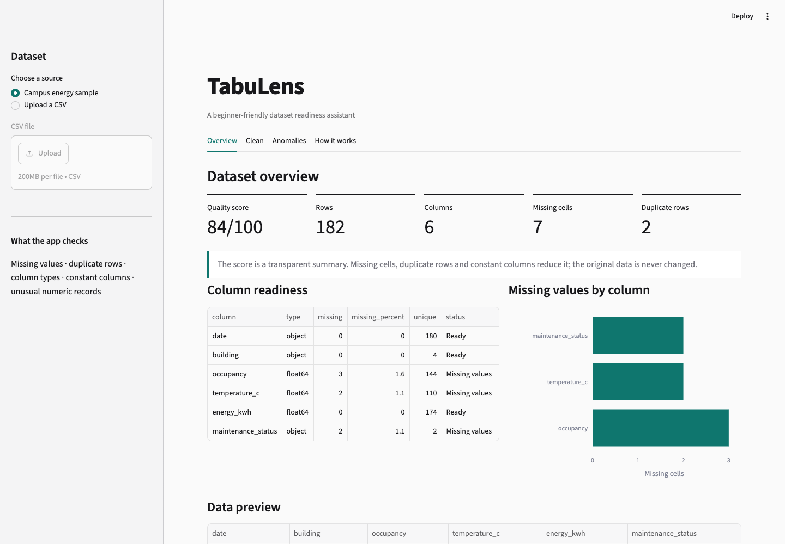
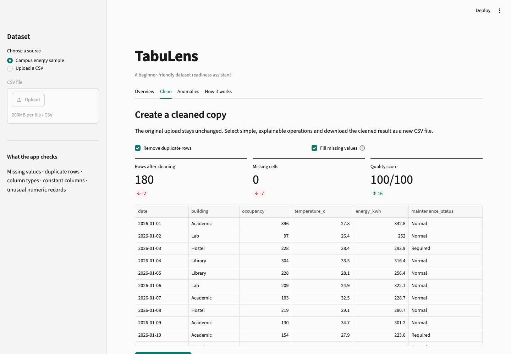
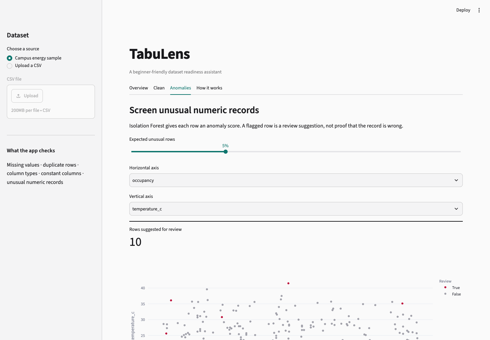

# TabuLens

[](https://github.com/Divyadhiman1433/tabulens/actions/workflows/ci.yml)
[](runtime.txt)
[](LICENSE)

TabuLens is a beginner-friendly Streamlit application for checking whether a CSV dataset is ready for analysis. It profiles common quality problems, creates a separate cleaned copy, visualizes missing values, and uses Isolation Forest to suggest unusual numeric records for review.

The project is designed for AI Programming Tools (AIPT) and follows the Python and AI application-development syllabus: file handling, functions, modules, object-oriented programming, NumPy, Pandas, visualization, preprocessing, and a small scikit-learn component.



## What it does

- Reads an uploaded CSV file or the included campus-energy sample.
- Reports rows, columns, data types, missing cells, duplicates, and constant columns.
- Produces a transparent quality score from those observable issues.
- Creates a cleaned copy using duplicate removal, median filling, and mode filling.
- Screens numeric records with Isolation Forest and displays the result interactively.
- Exports the cleaned data without modifying the original upload.





## Demonstration result

| Measure | Source | Cleaned copy |
| --- | ---: | ---: |
| Rows | 182 | 180 |
| Missing cells | 7 | 0 |
| Duplicate rows | 2 | 0 |
| Readiness score | 84/100 | 100/100 |

At the default 5% setting, Isolation Forest suggests 10 rows for review. These are not removed automatically.

## Academic deliverables

The first [GitHub release](https://github.com/Divyadhiman1433/tabulens/releases) contains the report, presentation, sample data, cleaned output, readiness table, anomaly records, and reproducible results bundle. The report and deck are generated from the same project results and verified screenshots used in this README.

## Run locally

```bash
python -m venv .venv
source .venv/bin/activate
python -m pip install -e ".[dev]"
python scripts/generate_sample.py
streamlit run streamlit_app.py
```

Open `http://localhost:8501`.

To rebuild the result bundle, report, and editable presentation:

```bash
python -m pip install -e ".[dev,artifacts]"
make artifacts
```

## Project structure

```text
streamlit_app.py             Deployment entry point
app.py                       Streamlit interface
src/tabulens/analysis.py     Profiling, cleaning, and anomaly logic
src/tabulens/sample_data.py  Reproducible demonstration dataset
data/                        Included sample CSV
tests/                       Unit tests
content/                     Shared academic content
scripts/                     Dataset and artifact builders
assets/                      Figures and verified screenshots
docs/                        Academic documentation
```

## Verification

```bash
ruff check .
pytest -q
docker build -t tabulens .
```

## Interpretation boundary

The quality score is a simple, documented heuristic. Anomaly flags mean that a record is unusual relative to the other numeric observations; they do not prove that the record is wrong. A person who understands the dataset should decide what to change.

## License

MIT
